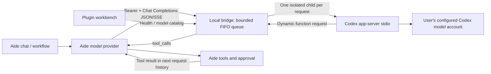

# Codex Bridge · Codex 模型桥接

An independent Aide plugin and optional local host service. Connect an installed, signed-in Codex CLI to Aide's **OpenAI-compatible Chat Completions** provider. No Aide core changes, Codex binaries, account tokens or user chat histories are bundled.

独立插件 + 宿主机服务，把本机 Codex 接入 Aide 模型提供商。支持 Windows、macOS、Linux 的安装与启动入口；无需 PowerShell。插件自己的版本为 **0.2.0**，不随 Aide RC 号命名。

## Graphical setup / 无终端安装与日常操作

1. From [Release 0.2.0](https://github.com/skyelan1999/aide-pkg-CodexBridge/releases/tag/v0.2.0), download the native **manager** matching the Codex host OS and CPU. macOS: unzip and copy **Codex Bridge Manager.app** to Applications; Windows: unzip and run **CodexBridgeManager.exe**; Linux: extract the archive and launch the executable from the graphical desktop. Complete any normal OS approval for this unsigned preview; do not disable OS protections.
2. The manager opens a local setup page. Click **Install/update**, then **Start**. Node.js 18+ and a previously installed/signed-in Codex CLI are prerequisites. The standalone manager binary does not need Node merely to open its setup page. It does not install Node/Codex, log into accounts or add a startup task. An older bridge started outside the manager must be closed once before takeover; it is never killed automatically.
3. Copy the **manager key** from the native setup page into Aide → Codex Bridge → Settings → **Manager pairing key**. Use `http://host.docker.internal:8788` for Docker Desktop or `http://127.0.0.1:8788` for native Aide. This is a separate administration credential, not the model API key; do not paste it into chat. After pairing, the plugin's buttons actually install/update, start, stop, restart, diagnose, repair permissions and uninstall the owned bridge.
4. For model-provider setup, copy the separate **model API key** from the native setup page. Configure Aide's model provider and fetch models as before. Provider settings are never overwritten automatically.

中文：首次下载原生管理器并双击 → 图形页面点“安装／更新”和“启动” → 将管理密钥在插件设置里配对一次。之后日常维护直接用插件工作台按钮，无需输入 Shell 命令。管理器是独立常驻进程，停止推理桥接后仍可再次启动；点原生页面“退出管理器”会停止它管理的桥接并退出。卸载按钮仅移除桥接程序，保留配置、模型密钥和独立管理器，便于重新安装。

管理器仅监听本机回环，不自动改防火墙或提供商。Linux Docker 需使用管理员配置的宿主网络或受控本地转发；`host-gateway` 名称映射本身不会让容器访问宿主回环监听。图形页面与插件按钮不会暴露任意命令执行或自选文件写入接口。Windows 使用参数数组和原生进程树终止，不使用 PowerShell。

The manager holds a separate pairing key in the user's profile; POSIX files use 0600 under a 0700 directory, Windows relies on the user's profile ACL. It controls only a fixed installation directory and fixed operations. It is not an OS sandbox against other programs running as the same account. The manager key grants lifecycle authority; enable the plugin and pair only with a trusted local Aide backend. No arbitrary command/path or remote URL is accepted by the lifecycle tool. Keep the manager open while using plugin controls. Manual shell launchers remain an advanced fallback below.

## Architecture / 编排



Aide owns tools, approval and conversation history. The adapter reconstructs the supplied text history into a fresh ephemeral Codex thread for each request; this is **not** native multi-role replay or a continuation of a desktop Codex chat. The first dynamic-tool call is handed back to Aide, then that child is closed. The next HTTP request carries Aide's updated history. Hidden Codex reasoning and pending tool state are not preserved.

## Quick start / 安装配置

1. Install **Node.js 18+** and the official Codex CLI on the host where Codex runs. Run `codex login` there. Keep the login under that OS user. The plugin does not read or copy login-token files.
2. Extract the plugin ZIP. Install the host component:

| Platform | Install | Default location | Start from installed location |
| --- | --- | --- | --- |
| Windows | `install.cmd` | `%LOCALAPPDATA%\aide-codex-bridge` | `start.cmd` |
| macOS | `sh install.command` | `~/Library/Application Support/aide-codex-bridge` | `sh start.command` |
| Linux | `sh install.sh` | `$XDG_DATA_HOME/aide-codex-bridge` or `~/.local/share/aide-codex-bridge` | `sh start.sh` |

Command-line alternative on all three: `node manage.cjs install "target directory"`. No administrator install, scheduled task or automatic startup service is added. Node and Codex are prerequisites, not silently downloaded. On Windows, native `.exe` and the official npm `codex.cmd` installation are supported: the resolver launches its adjacent `@openai/codex/bin/codex.js` through Node, never by evaluating a `.cmd` file in a shell.

3. In the installed directory run `node manage.cjs doctor`. Edit `config.json` as needed. Then start the bridge and keep its terminal open. Ctrl+C stops the bridge. Reinstalling updates component files while preserving `config.json` and `data/bridge.key`; unrelated nonempty directories are refused.
4. Import the **same ZIP** into Aide → Plugins → Upload, and enable **Codex Bridge**. Open the plugin workbench for bilingual guidance and connection checks. Import alone does not install/start the host service or change any provider.
5. Run `node manage.cjs key` **locally** and copy the generated bridge key into Aide's model-provider API Key field. It is a local bridge key, not an OpenAI Platform API key. Never paste it into chat or Git. The optional plugin diagnostic key permits authenticated catalog checks only; the provider key must still be set separately.

| Aide provider field | Value |
| --- | --- |
| Type | OpenAI compatible / Chat Completions |
| Base URL (native Aide on same host) | `http://127.0.0.1:8787/v1` |
| Base URL (Docker Desktop Aide) | `http://host.docker.internal:8787/v1` |
| API Key | Locally generated bridge key |
| Model | An ID from the authenticated catalog; test actual access with a short request |

中文：解压安装包 → 宿主机登录 Codex → 安装并启动桥接 → 在 Aide 导入同一 ZIP → 打开工作台检查连接 → 单独配置 Aide 模型提供商的地址、密钥与模型。不会继承 Codex 桌面正在进行的聊天。

### macOS/Linux launcher permissions / 启动权限修复

If double-clicking a `.command` file says you do not have permission, open Terminal in the **extracted plugin directory** and run:

```sh
node manage.cjs repair-permissions
sh install.command
```

Linux uses `sh install.sh` for the second command. Shell invocation does not require the script's executable bit. After host installation, repair an existing default macOS installation with:

```sh
node "$HOME/Library/Application Support/aide-codex-bridge/manage.cjs" repair-permissions
```

中文：ZIP 自带执行位，但插件导入、同步或部分解压工具可能把 `.command` 写成普通只读脚本。先进入解压目录运行修复命令，或直接 `sh install.command`。该命令仅将本组件八个 `.sh`/`.command` 入口恢复为 `0755`；先检查完整白名单，拒绝符号链接，不修改配置、密钥、其他文件或系统隔离标记，也不启动服务。自选安装目录可运行 `node manage.cjs repair-permissions "实际安装目录"`。如果是系统阻止打开、目录写入失败或 Codex 登录权限错误，请保留完整报错另行排查，不能把它们都当作执行位丢失。

The repair command validates the complete launcher allowlist before changing modes. It does not run the bridge, change credentials/firewall settings or remove OS quarantine. It is not a remedy for every permissions or account error. Importing the plugin alone still does not install the host service.

### Docker and network access

Default binding is **127.0.0.1**, for native same-host Aide. Docker reachability depends on the host and Docker network. If necessary, deliberately change `host` to `0.0.0.0` in the bridge `config.json`, then use `host.docker.internal`. This exposes the listener on IPv4 interfaces: restrict host firewall access to the required local/Docker network; do not forward it to the Internet. No firewall or Docker-network configuration is changed by this plugin. Linux Docker additionally needs an explicit `host.docker.internal:host-gateway` mapping. A remote Aide backend can use an administrator-configured SSH tunnel; remote host management is outside this plugin.

Default proxy is empty (inherits process environment). Set `proxy` in `config.json` only if Codex needs a host-specific HTTP(S)/SOCKS proxy. This affects the Codex child, not OS settings. Do not assume a particular proxy port. It is not a general HTTP proxy server.

### Host commands

```sh
node manage.cjs doctor
node manage.cjs start
node manage.cjs key
```

`key` intentionally displays the local key in your terminal. Do not capture that command in shared logs. Generated files live outside Git and ZIP allowlists. On POSIX, generated key mode is 0600; Windows access relies on your user-profile ACLs. Stop the host service before upgrading/removing it. Removing the plugin from Aide does not stop a separately running host process.

## 获取 token / Get the local bridge key

**先安装宿主组件。** 在 Aide 上传 ZIP 只会安装插件，不会创建下面的宿主目录。若目录不存在，先解压 ZIP，在解压目录运行对应安装器：

| 系统 / OS | 安装 / Install | 安装后取密钥入口 / Key launcher |
| --- | --- | --- |
| Windows CMD | `install.cmd` | 安装目录双击 `get-key.cmd` |
| macOS Terminal | `sh install.command` | 安装目录运行 `sh get-key.command`，或双击该文件 |
| Linux Terminal | `sh install.sh` | 安装目录运行 `sh get-key.sh` |

默认目录安装完成后，也可以从任意目录复制执行对应系统的命令：

Windows **CMD**（不要在 macOS/Linux 终端使用 `%LOCALAPPDATA%`）：

```cmd
node "%LOCALAPPDATA%\aide-codex-bridge\manage.cjs" key
```

macOS：

```sh
node "$HOME/Library/Application Support/aide-codex-bridge/manage.cjs" key
```

Linux：

```sh
node "${XDG_DATA_HOME:-$HOME/.local/share}/aide-codex-bridge/manage.cjs" key
```

自选安装目录：运行该目录的 `get-key` 入口，或 `node manage.cjs key "实际安装目录"`。取密钥不会在未安装的解压目录偷偷创建另一个密钥；未安装时会明确提示先安装。安装器会打印适合当前系统的完整取密钥命令。输出只填写到 Aide 模型提供商 API Key / 插件可选诊断密钥，不发到聊天里。The bridge key is generated locally; it is not your Codex login token.

## 插件内安装与卸载 / Lifecycle workbench

打开插件工作台 → **如何使用**，选择运行 Codex 的宿主系统，再选择 **安装宿主组件 / 获取密钥 / 启动 / 停止 / 卸载宿主组件**。每一步展示该系统可直接执行的命令、前提条件和验证方式。默认系统仅按浏览器设备提示；远程/Docker场景请自己选择真正的 Codex 宿主系统。页面不具备跨 Docker 操作宿主机的权限，不会假装自动安装或自动卸载。需要在宿主终端执行所示命令。

| 系统 | 卸载宿主组件（先停止） |
| --- | --- |
| Windows | 安装目录运行 `uninstall.cmd` |
| macOS | 安装目录运行 `sh uninstall.command` |
| Linux | 安装目录运行 `sh uninstall.sh` |

也可从解压包执行 `node manage.cjs uninstall "实际安装目录"`。卸载只删除明确清单中的本组件程序文件，**保留配置、桥接密钥和目录标记**（Windows 还保留当前卸载入口，以便卸载窗口正常结束）；不会递归删除用户目录、未知文件、Node、Codex CLI 或 Codex 登录数据。重新运行安装器会恢复程序并沿用原密钥。新版本由 start 入口启动时记录 PID；运行中的实例拒绝升级/卸载。旧版本或手工启动的实例也必须先在原终端 Ctrl+C 停止。若要彻底清除保留数据，先确认路径及备份，再自行删除保留目录。

**卸载 Aide 插件本身**：Aide → 插件 → 已安装 → Codex Bridge → 卸载。它和宿主服务是两部分，移除其中之一不会自动停止/删除另一部分。可用工作台“检查连接”核验服务是否停止；连接可达不等于插件已安装或模型已验收。

## Capabilities and limits

- `GET /health`: minimal unauthenticated service identity/version; not a login or inference check.
- `GET /v1/models`: Bearer-authenticated Codex catalog; catalog presence is **not an entitlement check**.
- `POST /v1/chat/completions`: Bearer-authenticated JSON/SSE, function tools, `response_format=text/json_object/json_schema`, `reasoning_effort`.
- Defaults: 10 active requests, 40 queued, FIFO, 45-second queue deadline, 180-second active deadline, 8 MiB HTTP body, 4 MiB answer cap. Client disconnects stop corresponding children; capacity errors before text output retry at most twice, with 3/6-second delay. No retries after partial output or tool handoff. Ten slots share the same account quota, not a tenfold-speed promise.
- `off` reasoning maps to the minimum effort advertised by the selected model; `auto` uses its default. Sampling/output-token parameters are accepted for compatibility but not mapped; no fabricated token usage is returned.
- Only text content, `n=1`, and tool choice `auto/none` are accepted. Images/audio, legacy `functions`, forced tool choice and multiple simultaneous tool handoffs are unsupported and fail explicitly.
- Children use a temporary working directory, read-only sandbox, disabled shell/web search/plugin suggestions and disabled configured MCP servers. Unsupported interaction requests fail rather than being auto-approved. These are Codex configuration restrictions, **not a separate credential sandbox**: the Codex child necessarily runs under the logged-in OS account and may use its local Codex configuration. This plugin neither imports that account's credentials into Aide nor promises isolation from a compromised host.
- No persistent bridge document/chat cache or desktop-thread takeover. Normal Aide and Codex diagnostic/retention rules still apply. Selected prompts are sent by Codex to its configured provider; a local HTTP bridge is not offline inference.

## Development and acceptance

No npm dependencies are required. Build and test:

```sh
node scripts/build.cjs
python scripts/package-codex-bridge.py --out dist
node --test scripts/*.test.cjs
```

The deterministic 21-file plugin ZIP uses an explicit allowlist. It contains host launchers/runtime but no binaries, local config, auth, keys or test evidence. Run the generated ZIP through Aide's normal plugin validation before distributing.

```sh
# Real host catalog only, no inference
node scripts/live-acceptance.cjs
# Explicit synthetic JSON + SSE inference; uses the logged-in Codex account quota
node scripts/live-acceptance.cjs --infer --tools
```

See [architecture](docs/ARCHITECTURE.md), [acceptance record](docs/ACCEPTANCE.md) and [source provenance](docs/PROVENANCE.md). Cross-platform CI exercises native Node child processes, install/update, Unicode/space paths, queue/cancellation and npm-shim resolution. It does not prove live Codex inference on every OS/CPU or Windows version.

Official protocol reference: [Codex app-server](https://learn.chatgpt.com/docs/app-server). This integration uses an evolving protocol; changing Codex versions requires revalidation. Wrapper/runtime are MIT, based on the supplied MIT reference bundle. Codex itself and model/account access are not redistributed by this repository.
