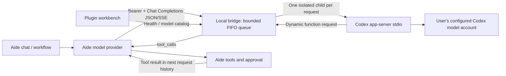

# Codex Bridge · Codex 模型桥接

An independent Aide plugin and optional local host service. Connect an installed, signed-in Codex CLI to Aide's **OpenAI-compatible Chat Completions** provider. No Aide core changes, Codex binaries, account tokens or user chat histories are bundled.

独立插件 + 宿主机服务，把本机 Codex 接入 Aide 模型提供商。支持 Windows、macOS、Linux 的安装与启动入口；无需 PowerShell。插件自己的版本为 **0.1.0**，不随 Aide RC 号命名。

## Architecture / 编排



Aide owns tools, approval and conversation history. The adapter reconstructs the supplied text history into a fresh ephemeral Codex thread for each request; this is **not** native multi-role replay or a continuation of a desktop Codex chat. The first dynamic-tool call is handed back to Aide, then that child is closed. The next HTTP request carries Aide's updated history. Hidden Codex reasoning and pending tool state are not preserved.

## Quick start / 安装配置

1. Install **Node.js 18+** and the official Codex CLI on the host where Codex runs. Run `codex login` there. Keep the login under that OS user. The plugin does not read or copy login-token files.
2. Extract the plugin ZIP. Install the host component:

| Platform | Install | Default location | Start from installed location |
| --- | --- | --- | --- |
| Windows | `install.cmd` | `%LOCALAPPDATA%\aide-codex-bridge` | `start.cmd` |
| macOS | `sh install.command` | `~/Library/Application Support/aide-codex-bridge` | `sh start.command` |
| Linux | `sh install.sh` | `$XDG_DATA_HOME/aide-codex-bridge` or `~/.local/share/aide-codex-bridge` | `sh start.sh` |

Command-line alternative on all three: `node manage.cjs install "target directory"`. No administrator install, scheduled task or automatic startup service is added. Node and Codex are prerequisites, not silently downloaded. On Windows, native `.exe` and the official npm `codex.cmd` installation are supported: the resolver launches its adjacent `@openai/codex/bin/codex.js` through Node, never by evaluating a `.cmd` file in a shell.

3. In the installed directory run `node manage.cjs doctor`. Edit `config.json` as needed. Then start the bridge and keep its terminal open. Ctrl+C stops the bridge. Reinstalling updates component files while preserving `config.json` and `data/bridge.key`; unrelated nonempty directories are refused.
4. Import the **same ZIP** into Aide → Plugins → Upload, and enable **Codex Bridge**. Open the plugin workbench for bilingual guidance and connection checks. Import alone does not install/start the host service or change any provider.
5. Run `node manage.cjs key` **locally** and copy the generated bridge key into Aide's model-provider API Key field. It is a local bridge key, not an OpenAI Platform API key. Never paste it into chat or Git. The optional plugin diagnostic key permits authenticated catalog checks only; the provider key must still be set separately.

| Aide provider field | Value |
| --- | --- |
| Type | OpenAI compatible / Chat Completions |
| Base URL (native Aide on same host) | `http://127.0.0.1:8787/v1` |
| Base URL (Docker Desktop Aide) | `http://host.docker.internal:8787/v1` |
| API Key | Locally generated bridge key |
| Model | An ID from the authenticated catalog; test actual access with a short request |

中文：解压安装包 → 宿主机登录 Codex → 安装并启动桥接 → 在 Aide 导入同一 ZIP → 打开工作台检查连接 → 单独配置 Aide 模型提供商的地址、密钥与模型。不会继承 Codex 桌面正在进行的聊天。

### Docker and network access

Default binding is **127.0.0.1**, for native same-host Aide. Docker reachability depends on the host and Docker network. If necessary, deliberately change `host` to `0.0.0.0` in the bridge `config.json`, then use `host.docker.internal`. This exposes the listener on IPv4 interfaces: restrict host firewall access to the required local/Docker network; do not forward it to the Internet. No firewall or Docker-network configuration is changed by this plugin. Linux Docker additionally needs an explicit `host.docker.internal:host-gateway` mapping. A remote Aide backend can use an administrator-configured SSH tunnel; remote host management is outside this plugin.

Default proxy is empty (inherits process environment). Set `proxy` in `config.json` only if Codex needs a host-specific HTTP(S)/SOCKS proxy. This affects the Codex child, not OS settings. Do not assume a particular proxy port. It is not a general HTTP proxy server.

### Host commands

```sh
node manage.cjs doctor
node manage.cjs start
node manage.cjs key
```

`key` intentionally displays the local key in your terminal. Do not capture that command in shared logs. Generated files live outside Git and ZIP allowlists. On POSIX, generated key mode is 0600; Windows access relies on your user-profile ACLs. Stop the host service before upgrading/removing it. Removing the plugin from Aide does not stop a separately running host process.

## Capabilities and limits

- `GET /health`: minimal unauthenticated service identity/version; not a login or inference check.
- `GET /v1/models`: Bearer-authenticated Codex catalog; catalog presence is **not an entitlement check**.
- `POST /v1/chat/completions`: Bearer-authenticated JSON/SSE, function tools, `response_format=text/json_object/json_schema`, `reasoning_effort`.
- Defaults: 10 active requests, 40 queued, FIFO, 45-second queue deadline, 180-second active deadline, 8 MiB HTTP body, 4 MiB answer cap. Client disconnects stop corresponding children; capacity errors before text output retry at most twice, with 3/6-second delay. No retries after partial output or tool handoff. Ten slots share the same account quota, not a tenfold-speed promise.
- `off` reasoning maps to the minimum effort advertised by the selected model; `auto` uses its default. Sampling/output-token parameters are accepted for compatibility but not mapped; no fabricated token usage is returned.
- Only text content, `n=1`, and tool choice `auto/none` are accepted. Images/audio, legacy `functions`, forced tool choice and multiple simultaneous tool handoffs are unsupported and fail explicitly.
- Children use a temporary working directory, read-only sandbox, disabled shell/web search/plugin suggestions and disabled configured MCP servers. Unsupported interaction requests fail rather than being auto-approved. These are Codex configuration restrictions, **not a separate credential sandbox**: the Codex child necessarily runs under the logged-in OS account and may use its local Codex configuration. This plugin neither imports that account's credentials into Aide nor promises isolation from a compromised host.
- No persistent bridge document/chat cache or desktop-thread takeover. Normal Aide and Codex diagnostic/retention rules still apply. Selected prompts are sent by Codex to its configured provider; a local HTTP bridge is not offline inference.

## Development and acceptance

No npm dependencies are required. Build and test:

```sh
node scripts/build.cjs
python scripts/package-codex-bridge.py --out dist
node --test scripts/*.test.cjs
```

The deterministic 15-file plugin ZIP uses an explicit allowlist. It contains host launchers/runtime but no binaries, local config, auth, keys or test evidence. Run the generated ZIP through Aide's normal plugin validation before distributing.

```sh
# Real host catalog only, no inference
node scripts/live-acceptance.cjs
# Explicit synthetic JSON + SSE inference; uses the logged-in Codex account quota
node scripts/live-acceptance.cjs --infer
```

See [architecture](docs/ARCHITECTURE.md), [acceptance record](docs/ACCEPTANCE.md) and [source provenance](docs/PROVENANCE.md). Cross-platform CI exercises native Node child processes, install/update, Unicode/space paths, queue/cancellation and npm-shim resolution. It does not prove live Codex inference on every OS/CPU or Windows version.

Official protocol reference: [Codex app-server](https://learn.chatgpt.com/docs/app-server). This integration uses an evolving protocol; changing Codex versions requires revalidation. Wrapper/runtime are MIT, based on the supplied MIT reference bundle. Codex itself and model/account access are not redistributed by this repository.
