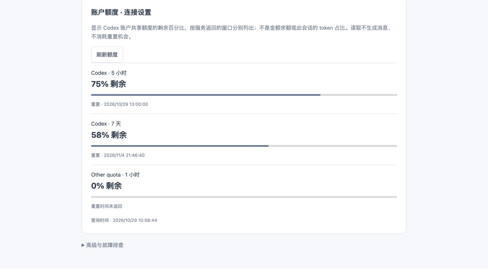
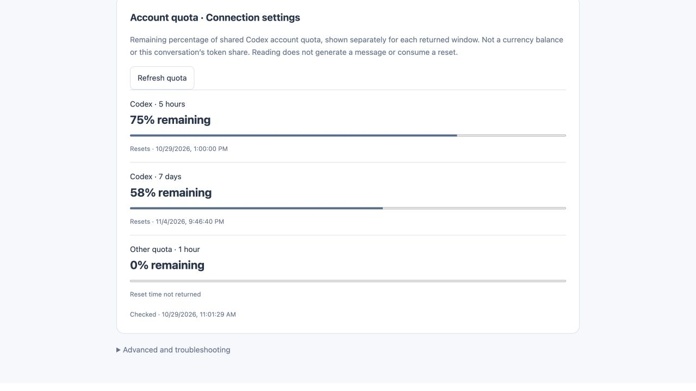
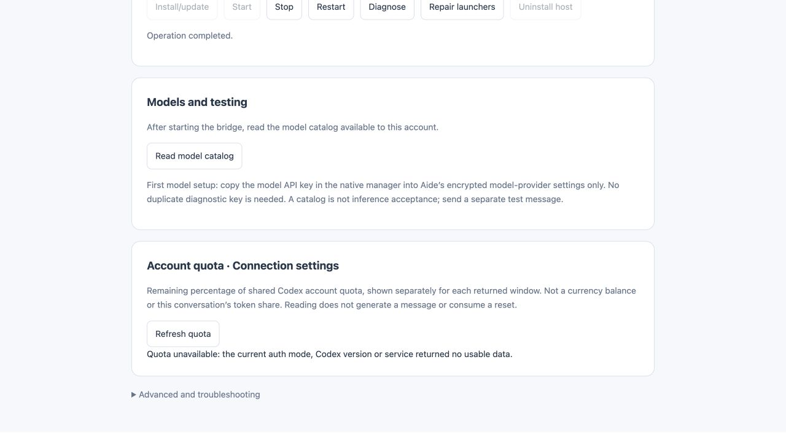

# Codex Bridge quota acceptance · 2026-10-29

Central request: [Aide #604](https://github.com/skyelan1999/aide/issues/604). Implementation repository and candidate: aide-pkg-CodexBridge 0.3.0, PR #8. This extends the earlier guided-setup acceptance; previous source/artifact hashes in ACCEPTANCE-0.3.0.json describe the pre-quota candidate and are superseded by QUOTA-ACCEPTANCE-0.3.0.json for this build.

## Implemented

Authenticated `/v1/usage` → Codex `account/rateLimits/read`, manager `/api/usage`, plugin `codex_bridge_usage`, and the workbench connection-settings quota panel. Each layer returns allowlisted quota fields; no raw account/config payload. Prefer per-limit buckets, retain separate primary/secondary windows, subtract used percentage from 100 with clamping; null/missing values never imply 100%. The UI clears previous percentages after an unavailable read or a stopped/disconnected host. It reads once on page entry when ready and on explicit refresh, without background polling. No account login, auth-file read, inference, reset consumption or Aide provider change.

## Executed checks

- Node tests: 40 passed, including normalization, legacy/multiple buckets, zero/exhausted/missing/malformed quota, metadata bounds, credential filtering, HTTP authentication and read-only RPC methods. Log: local `.agent-state/quota-node-tests.log`.
- Linux ARM64 Go race/vet: passed. macOS ARM64 native test binary: passed. Real temporary manager installs and starts a Node bridge with a synthetic Codex executable, verifies the account-quota HTTP path and stops its owned child. No real account is used in these lifecycle tests.
- Browser: actual generated workbench → plugin tool handler → paired Go manager → real Node bridge → synthetic Codex stdio. Verified 5-hour 75%, 7-day 58%, another bucket 0%, missing reset time, Chinese/English layout, automatic entry read and explicit refresh. Changing synthetic RPC data to null clears all previous percentages and displays unavailable. This fixture is not a full Aide-core browser integration test.
- A single read through the installed real Codex CLI 0.164.0-alpha.11.1 did not return quota data. Therefore real-account percentage availability is **NOT ACCEPTED** on this host; the implementation must show unavailable rather than synthesize a value. No inference or auth mutation was attempted.

## Evidence

## Delivery boundary

No 9999 deployment, provider changes, tag, GitHub Release or marketplace deployment in this task. CI and final artifact identities are recorded separately in QUOTA-ACCEPTANCE-0.3.0.json. Windows/Linux real-account desktop acceptance remains NOT_RUN; hosted cross-platform tests do not replace it. Existing production bridge and Aide remain unchanged.
